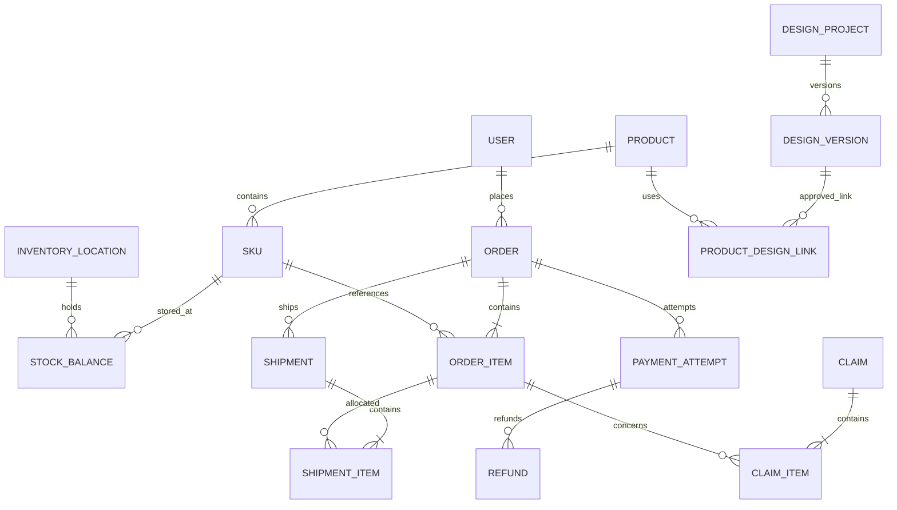

# 데이터 모델·상태 규칙 v0.3

논리 ERD 초안이다. DB 제품·ORM·마이그레이션 도구는 미정이다. 주문·결제 관련 엔티티는 해당 단계 선택 후 구현한다.

## 핵심 엔티티와 관계

| 영역 | 엔티티·주요 속성 | 관계 |
|---|---|---|
| 회원·정책 | User, Address, PolicyVersion, ConsentRecord | User 1:N 주소·동의, 정책 버전 1:N 동의 |
| 권한 | Role, Permission, UserRole, RolePermission | 사용자↔역할↔권한 N:M |
| 상품 | Product, Category, ProductCategory, ProductImage, SizeGuide | 상품↔카테고리 N:M, 상품 1:N 이미지·SKU |
| 옵션 | OptionType, OptionValue, SKU, SKUOptionValue | SKU↔옵션값 N:M, 상품 내 옵션 조합 유일 |
| 가격 | PriceVersion: sku_id, amount, currency, valid_from/to | SKU 1:N 가격 이력 |
| 재고 | InventoryLocation, StockBalance, InventoryMovement | SKU+위치별 잔고 유일, 변경 원장 N건 |
| 예약·할당 | StockReservation, StockAllocation | 주문 품목·SKU·위치·수량·상태·만료시간 |
| 혜택 | Promotion, Coupon, CouponIssue, CouponRedemption | 발급과 사용 예약/확정/복원 이력 분리 |
| 장바구니 | Cart, CartItem | 장바구니 1:N SKU·수량 |
| 주문 | Order, OrderItem, OrderAdjustment | 주문 1:N 품목·조정 내역 |
| 결제 | PaymentAttempt, PaymentTransaction, Refund, RefundItem | 주문 1:N 시도, 시도 1:N 거래·환불 |
| 배송 | Shipment, ShipmentItem, ShipmentEvent | 주문 1:N 배송, 배송 품목이 주문품목·수량 연결 |
| 클레임 | Claim, ClaimItem, Inspection | 클레임 1:N 품목, 원주문 품목·대체 SKU 연결 |
| 정산 | SettlementBatch, SettlementLine, ReconciliationIssue | 정산 묶음 1:N 항목, 항목→PG 거래 |
| CS | SupportTicket, SupportMessage | 문의→사용자·선택적 주문/클레임, 답변 N건 |
| 시안 | DesignProject, DesignVersion, DesignAsset, DesignVersionAsset, DesignComment, ProductDesignLink | 프로젝트 1:N 버전, 버전↔자산 N:M, 버전→검토·상품 연결 |
| 비동기·감사 | OutboxEvent, InboxEvent, ConsumerReceipt, NotificationDelivery, AuditLog | 이벤트 ID·업무 ID·소비자·처리 결과 연결 |

## 공통 제약

기본키·생성/변경 시각, 경합 데이터의 버전을 둔다. 시각은 UTC로 저장하고 표시·영업일 계산은 정책 시간대로 변환한다. 통화는 명시적으로 저장하고 수량·금액 범위와 외래키를 검증한다.

SKU 코드, 상품 내 옵션 조합, 공급자별 PG 거래 ID·수신 이벤트 ID는 유일하다. 상품 삭제 대신 판매 종료로 과거 참조를 보존한다. 주문 품목에 상품명·옵션·단가·할인 배분·세금·고지 정책을 스냅샷으로 저장하고 주소록 변경이 주문 주소를 바꾸지 않게 한다.

## 재고 불변식

판매 가능 = 물리 재고 − 격리 − 활성 예약 − 판매 할당.

- 입고: 물리 재고 증가, 검사 필요 시 격리도 증가.
- 결제/주문 확정: 예약 감소와 판매 할당 증가를 원자적으로 처리. 물리 재고는 유지.
- 실제 출고: 물리 재고와 판매 할당을 함께 감소.
- 출고 전 취소: 예약 또는 판매 할당 해제.
- 반품 입고: 물리 재고·격리 증가. 검수 통과 시 격리 해제.
- 분실·폐기·실사: 변경 원장에 사유·담당자·근거 기록. 음수 가용 수량을 만드는 조정은 자동 저장 대신 부족 할당 예외 처리.

DB 조건부 갱신 또는 행 잠금으로 초과 예약을 막는다. 원장 이벤트와 잔고 갱신을 한 트랜잭션으로 처리한다. 조정은 직접 덮어쓰지 않는다.

## 결제 도입 시 주문 확정

1. 서버 견적에 만료·정책 버전을 부여하고 주문 생성 시 재검증한다.
2. 주문·품목 스냅샷·재고 예약·쿠폰 예약을 DB 트랜잭션으로 생성한다.
3. 별도 결제 시도에서 PG 처리. 외부 호출 동안 DB 트랜잭션을 유지하지 않는다.
4. 서버에서 PG 주문 ID·금액·통화·상태를 검증한다.
5. 결제 완료·재고 할당 전환·쿠폰 확정·Outbox 기록을 원자 처리한다.
6. 워커가 알림·후속 작업을 처리한다.

결제 없이 주문을 받는 경우의 확정 조건은 Q03 결정 전 구현하지 않는다.

## 상태와 예외

| 객체 | 상태 예시 |
|---|---|
| 주문 | 결제 대기(해당 시) → 확정 → 처리 중 → 완료 / 취소 |
| 결제 | 생성 → 진행 → 성공 / 실패 / 취소 / UNKNOWN |
| 배송 | 준비 → 포장 → 인계 → 배송 중 → 완료 / 예외 |
| 반품 | 접수 → 검토 → 회수 → 입고 → 검수 → 환불 대기(해당 시) → 종료 |
| 교환 | 접수 → 검토 → 회수·대체품 확보 → 검수 → 교환 출고 → 종료 |
| 환불 | 요청 → 처리 중 → 성공 / 실패 / UNKNOWN |
| 시안 | 작업 중 → 검토 요청 → 수정 요청 / 승인 → 보관 (제안) |

주문의 부분 출고·부분 취소·부분 환불 표시는 품목별 수량·금액에서 집계한다. 상태 전이는 업무 명령으로 수행하고 임의 상태 덮어쓰기를 금지한다.

PG 타임아웃은 실패가 아니라 UNKNOWN이다. 예약 만료 시 결제 진행 여부를 먼저 조회한다. 유예 만료·재고 해제 뒤 지연 승인이 발견되면 재확보하거나 승인 취소·환불 예외로 처리한다. 무기한 보류 방지를 위한 조회 주기·상한·담당자는 PG 정책에 맞춰 결정한다.

웹훅 중복·역순은 Inbox 유일성·허용 전이·PG 조회로 처리한다. 주문당 유효 성공 결제 1건을 초기 제안으로 하며 외부 중복 승인은 별도 취소·대사한다. 환불도 UNKNOWN과 조회 복구가 필요하다.

출고 확정과 취소 승인은 같은 품목 잠금/버전 검사로 직렬화한다. 이미 인계된 수량을 출고 전 취소로 처리하지 않는다. 포장 단계의 취소 허용은 운영 정책 미정이다.

취소 확정+원주문 출고 ≤ 주문 수량, 반품 완료 ≤ 해당 출고 수량을 유지한다. 진행 중 클레임은 대상 수량을 확보해 중복 신청을 차단한다. 교환 재출고는 원출고와 구분한다. 대체 SKU 예약·만료·품절·회수 지연을 추적하고 선출고 여부는 결정 전 확정하지 않는다.

환불 완료액+진행 중 환불 예약액 ≤ 환불 가능 총액을 잠금으로 보장한다. 할인 배분·배송비 조정·귀책·정책 버전·반올림 근거를 저장한다.

Outbox만으로 외부 호출 중복이 해결되지는 않는다. 소비자별 처리 기록·외부 멱등키·최대 재시도·격리 큐·감사 가능한 수동 재처리가 필요하다.

## 구현된 로컬 초안 상품·재고 모델 (2026-10-26)

이번 단계는 R03/R04의 일부 기반이다. SQLite Product 1:N SKU 1:N InventoryMovement, SKU별 단일 on_hand잔고를 둔다. 상품·SKU UUID, 상품/SKU version, 코드 및 상품 내 색상/사이즈 조합 유일성, 변경 원장의 request_id유일성을 적용한다. 로컬 파일은 .local/catalog.sqlite3이며 기존 샘플 진열과 분리한다.

재고 변경은 nonzero delta와 사유를 받아 BEGIN IMMEDIATE 트랜잭션 내에서 버전 검사→음수/상한 검사→잔고·버전 갱신→원장 추가를 함께 처리한다. 같은 요청 ID와 같은 내용은 기존 원장을 반환해 중복 증감을 막는다. 이전 요청 ID에 다른 내용이나 오래된 버전은409다. 주문 예약·할당·격리 없이 수동 물리 잔고만 다루므로 위 전체 재고 불변식의 완전 구현은 아니다.

## 상품명·분류 로컬 모델 v2 (2026-10-26)

Category(id, name, code) 1:N Product(category_id). Product.name은 고객 표시명, internal_name은 고유한 내부 관리명이다. 카테고리별 누적 발급 순번을 별도 보관하고 상품 생성과 번호 증가를 하나의 트랜잭션으로 처리한다. 번호는 최소 6자리이며 상한을 넘어도 자르지 않는다. 분류 수정 시 원래 내부명을 유지하므로 코드 접두사는 현재 분류가 아닌 최초 발급 분류를 나타낸다.

v1 자유 입력 category는 기본 분류에 대응하거나 별도 이관 분류로 보존한다. 기존 상품은 rowid 순서로 번호를 부여하며 UUID·이름·버전·옵션·재고·원장은 유지한다. user_version=2만 새 스키마로 간주하며 변환 실패는 트랜잭션 롤백한다. 실제 DB의 사전 온라인 백업과 호환 코드/DB 복구 지침은 docs/superpowers/plans/2026-10-26-product-names.md에 기록한다.

## 세부 분류·계절 v3

Category.parent_id는 null(대분류) 또는 대분류 ID다. 두 단계까지만 지원한다. is_active, sort_order, version을 추가한다. 기존 category는 모두 대분류로 보존한다. 신규 상품은 활성 세부분류를 참조하며 부모도 활성이어야 한다. 분류명 변경은 현재 분류 표시명에 반영하되 발급 관리명은 변경하지 않는다.

Product.seasons는 정규화 배열이다. SP/SU/FA/WI 순서를 사용하고 전부 선택은 ALL 하나로 저장한다. 기존 상품의 []는 계절 미지정이며 새로운 상품에는 허용하지 않는다. 새로운 번호 카운터 키는 (세부 category_id, 정규화 계절 코드)다. 상품 생성과 카운터 증가를 같은 트랜잭션에 묶는다. 최초 발급 카테고리/계절은 internal_name에 유지되고 현재 상품 속성과 달라질 수 있다. v3 이관은 원 상품·옵션·재고·원장과 기존 내부명을 보존한다.
# 옵션 기준정보 구현 v4 — WB30

OptionValue(id UUID,kind,name,name_key,code,is_active,sort_order,version). kind별name_key와code가고유하다. SKU.color_id/size_id는각각color/size기준값을참조하고(product_id,color_id,size_id)조합이유일하다. 활성·kind검증은생성트랜잭션에서수행한다. color/size문자열은등록당시표시스냅샷으로남고code는발급후유지한다.

기존v3에서테이블재생성없이기준값과연결컬럼을추가한다. 기존텍스트의정규화값을기준으로연결하고충돌없는C000001/S000001형코드를발급한다. 기존SKUcode는바꾸지않는다. 내부비교용color_key/size_key만domainID로갱신한다. 사용자삭제는도메인에제공하지않고사용중지로처리한다. 실제이관전SQLite온라인백업필수이며되돌리기는새로발생한쓰기의보존계획없이구버전백업으로덮어쓰지않는다.

## 원장 사유 분류 v5 — WB40

InventoryMovement에reason_code를추가한다. receipt/sale/gift/disposal/other_out/adjust_in/adjust_out/legacy 고정분류로신규입력과조회에사용한다. 기존원장은legacy,기존reason메모/수량/행위자/시각/잔고/request_id/payload불변이다. 사용자별새분류관리는이번범위밖. 원장정정은기존증감조정기록추가원칙이며원본수정/삭제를도입하지않는다.

## schema6 공급처 (WB43)

suppliers(id,name,is_active,version)와 이름 중복 방지 키를 추가한다. movements에 nullable supplier_id(FK), supplier_name(당시 이름)을 추가한다. 기존 원장·수량·버전·request_payload는 보존하고 이전 기록은 null로 유지한다. 입고처 이름 변경으로 과거 원장을 재작성하지 않는다.

## schema7 공급처 상세 정보 (WB46)

공급처에 11개 상세 문자열 컬럼을 NOT NULL DEFAULT ''로 추가한다. 이전 공급처명·활성·version과 모든 원장 필드는 유지한다. 입고 당시 supplier_name snapshot은 별도로 보존한다.

## schema8 국가별 주소 (WB47)

suppliers에 country_code/region/city 문자열 컬럼을 NOT NULL DEFAULT ''로 추가한다. 이전 주소·우편번호·공급처 정보·버전·원장은 보존하며 국가추론이나 기존주소 분해를 수행하지 않는다.

## 상품 이미지 — WB61

Product 1:N ProductImage. 이미지 ID, product_id, kind(design/model/garment), 파일명, 대체텍스트, 검증·재인코딩된 이미지 및 재시도 비교 정보를 별도 테이블로 유지한다. 고객용은 용도 분류이며 게시 상태가 아니다. 내부 시안은 공개 상품 자료로 자동 복제하지 않는다. 기존 상품·SKU·재고 원장은 변경하지 않는다. SQLite 신규 테이블 추가는 기존 데이터 보존 마이그레이션으로 수행한다.

## 공장 계정·배정·제작 요청 — WB62

Supplier 1:N FactoryAccount, Product 0..1 담당 Supplier. 관계 테이블로 구현하더라도 상품당 한 공장 제약을 서버에서 유지한다. 계정 비밀번호는 salt+PBKDF2 해시, 세션은 무작위 토큰의 해시/만료 저장. FactoryImageShare는 상품 배정과 design 이미지의 명시 공유 관계. ProductionRequest는 단일 상품·공장·복수 SKU별 수량과 생성 당시 이름/코드 스냅샷, 버전·상태를 가진다. 상태 이력은 행위자와 시각을 보존한다. 요청 생성/상태 변경은 SKU on_hand와 원장을 수정하지 않는다.

## 상품-공장 작업 상태 (WB63)

product_suppliers에 배정세대 식별자와 progress_status/updated_at을 추가하고 별도 작업 상태 이력에 상품·공장·배정세대·상태·메모·행위자·시각을 남긴다. 이력은 공장 변경 후에도 내부에서 보존한다. 기존 배정은 작업대기로 읽되 과거 진행을 추측한 이력을 만들지 않는다. SKU/입출고/제작요청 테이블은 상태 보고로 변경하지 않는다.

## schema12 옵션 사용 여부 (WB76)

skus.is_active INTEGER NOT NULL DEFAULT 1 CHECK(is_active IN (0,1)) 추가. 기존 SKU는 활성상태로 유지하고 ID·수량·원장·버전을 마이그레이션에서 변경하지 않는다. 신규도 기본 활성. API에서는 boolean으로 직렬화한다. 비파괴 추가컬럼이며 복구 시 컬럼 삭제·상태초기화 없이 이전앱으로 복귀한다.

## 발송·수령·검수 — WB86
Shipment는 Product/Supplier 스냅샷과 목적(sample/finished), 선택 ProductionRequest, 발송/수령/검수 상태·버전·날짜·운송정보를 가진다. Shipment 1:N ShipmentLine은 샘플 색상/사이즈 또는 완제품 SKU를 참조하고 발송/실수령/합격/불량 수량을 저장한다. Shipment 1:N ShipmentHistory는 처리자·상태변경 시각을 보존한다. 완제품 확정 line은 재고 Movement와 연결된다. 재고 잔액·원장 생성·line 연결·shipment 확정은 동일 트랜잭션이다. 샘플은 원장 연결을 생성하지 않는다. 누락=발송-실수령, 합격+불량=실수령. 정확 테이블/마이그레이션 버전은 검증 보고서에 기록한다.

WB86 실제 schema13: shipments(발송 header 및 lines JSON snapshot), shipment_history, shipment_stock_links(line_id PK/movement_id UNIQUE)을 추가한다. 논리적 ShipmentLine은 JSON에 보관하며 SKU 참조는 서버에서 검증한다. v12에서 마이그레이션 전 같은 디렉터리에 고유 .pre-v13-UUID.bak를 생성한다. 원본 products/skus/movements와 백업 비교 결과 모두 동일, 신규 발송0건 확인.

## 상품 게시 저장소 — WB87 / schema14
schema13에서 product_publications(product_id PK/FK, status draft|published|paused, price nullable integer, version)와 publication_history(id, product_id FK, status, price, created_at)를 추가한다. 미등록 게시 행은 draft/version0/price null로 읽으며 기존 상품을 일괄 게시하지 않는다. 게시 버전은 기본정보 상품 버전과 분리한다. 개별 직원 식별은 현행 단일 내부 관리자 인증 범위 밖이며 이력은 상태/가격 변경을 기록한다.

공개 상품은 기존 상품/카테고리/활성 SKU/고객 이미지에서 허용 필드만 읽는다. 원장·정확한 수량·공장·내부 시안은 공개 DTO가 아니다. schema13의 기존 상품·SKU·원장·이미지를 수정하지 않으며 이관 직전 .pre-v14-UUID.bak 백업을 생성한다. 이전 코드는 schema14를 거부하므로 코드만 되돌릴 수 없다. 이후 업무 데이터가 있으면 보존/대사 후 백업 복원하거나14 호환 코드로 전진 수정한다.

WB87 통합 주의: 별도 WB83 시안 편집기 작업의 DB 변경과 원본 schema14 게시 변경은 아직 병합하지 않았다. 향후 통합 시 마이그레이션 버전·테이블 생성 순서를 조정하고 양쪽 기존 데이터 보존 검증을 수행한다.

## 구매 고객 리뷰 — WB91 / schema15
product_reviews는 상품FK, 신뢰 고객/구매 식별자, 공개 작성자 표시명, rating1~5/body, hidden/deleted/reply, version, 작성/수정시각, 생성요청해시를 저장한다. 삭제되지 않은 고객·상품 조합 유일 인덱스와 공개 조회 인덱스를 둔다. review_history는 리뷰FK/action/reason/actor/snapshot/time으로 감사 이력을 보존한다. 고객 삭제는 논리 삭제이며 관리자 복원 불가다. 공개 DTO에는 고객/구매ID와 관리 감사정보를 포함하지 않는다. 평균과 개수는 공개·미삭제 행에서 조회 시 집계하며 별도 수동 평점 필드는 없다. 회원/주문 모델은 아직 연결되지 않았다.

## 판매 가격 확장 — schema16 / WB92
product_publications 및 publication_history에 discount_price INTEGER NULL CHECK(discount_price>=0)를 추가한다. 기본가와의 유효성은 서버에서검증하며 effective_price/discount_rate는 저장하지 않고 계산한다. 기존 가격/이력은 유지하고 schema15백업 후 추가한다.
