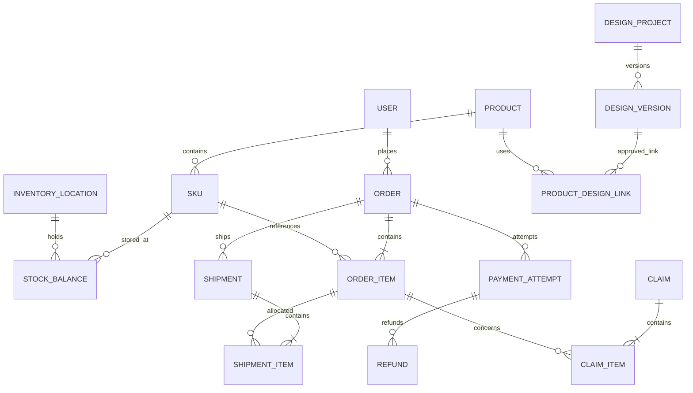

# 데이터 모델·상태 규칙 v0.3

논리 ERD 초안이다. DB 제품·ORM·마이그레이션 도구는 미정이다. 주문·결제 관련 엔티티는 해당 단계 선택 후 구현한다.

## 핵심 엔티티와 관계

| 영역 | 엔티티·주요 속성 | 관계 |
|---|---|---|
| 회원·정책 | User, Address, PolicyVersion, ConsentRecord | User 1:N 주소·동의, 정책 버전 1:N 동의 |
| 권한 | Role, Permission, UserRole, RolePermission | 사용자↔역할↔권한 N:M |
| 상품 | Product, Category, ProductCategory, ProductImage, SizeGuide | 상품↔카테고리 N:M, 상품 1:N 이미지·SKU |
| 옵션 | OptionType, OptionValue, SKU, SKUOptionValue | SKU↔옵션값 N:M, 상품 내 옵션 조합 유일 |
| 가격 | PriceVersion: sku_id, amount, currency, valid_from/to | SKU 1:N 가격 이력 |
| 재고 | InventoryLocation, StockBalance, InventoryMovement | SKU+위치별 잔고 유일, 변경 원장 N건 |
| 예약·할당 | StockReservation, StockAllocation | 주문 품목·SKU·위치·수량·상태·만료시간 |
| 혜택 | Promotion, Coupon, CouponIssue, CouponRedemption | 발급과 사용 예약/확정/복원 이력 분리 |
| 장바구니 | Cart, CartItem | 장바구니 1:N SKU·수량 |
| 주문 | Order, OrderItem, OrderAdjustment | 주문 1:N 품목·조정 내역 |
| 결제 | PaymentAttempt, PaymentTransaction, Refund, RefundItem | 주문 1:N 시도, 시도 1:N 거래·환불 |
| 배송 | Shipment, ShipmentItem, ShipmentEvent | 주문 1:N 배송, 배송 품목이 주문품목·수량 연결 |
| 클레임 | Claim, ClaimItem, Inspection | 클레임 1:N 품목, 원주문 품목·대체 SKU 연결 |
| 정산 | SettlementBatch, SettlementLine, ReconciliationIssue | 정산 묶음 1:N 항목, 항목→PG 거래 |
| CS | SupportTicket, SupportMessage | 문의→사용자·선택적 주문/클레임, 답변 N건 |
| 시안 | DesignProject, DesignVersion, DesignAsset, DesignVersionAsset, DesignComment, ProductDesignLink | 프로젝트 1:N 버전, 버전↔자산 N:M, 버전→검토·상품 연결 |
| 비동기·감사 | OutboxEvent, InboxEvent, ConsumerReceipt, NotificationDelivery, AuditLog | 이벤트 ID·업무 ID·소비자·처리 결과 연결 |

## 공통 제약

기본키·생성/변경 시각, 경합 데이터의 버전을 둔다. 시각은 UTC로 저장하고 표시·영업일 계산은 정책 시간대로 변환한다. 통화는 명시적으로 저장하고 수량·금액 범위와 외래키를 검증한다.

SKU 코드, 상품 내 옵션 조합, 공급자별 PG 거래 ID·수신 이벤트 ID는 유일하다. 상품 삭제 대신 판매 종료로 과거 참조를 보존한다. 주문 품목에 상품명·옵션·단가·할인 배분·세금·고지 정책을 스냅샷으로 저장하고 주소록 변경이 주문 주소를 바꾸지 않게 한다.

## 재고 불변식

판매 가능 = 물리 재고 − 격리 − 활성 예약 − 판매 할당.

- 입고: 물리 재고 증가, 검사 필요 시 격리도 증가.
- 결제/주문 확정: 예약 감소와 판매 할당 증가를 원자적으로 처리. 물리 재고는 유지.
- 실제 출고: 물리 재고와 판매 할당을 함께 감소.
- 출고 전 취소: 예약 또는 판매 할당 해제.
- 반품 입고: 물리 재고·격리 증가. 검수 통과 시 격리 해제.
- 분실·폐기·실사: 변경 원장에 사유·담당자·근거 기록. 음수 가용 수량을 만드는 조정은 자동 저장 대신 부족 할당 예외 처리.

DB 조건부 갱신 또는 행 잠금으로 초과 예약을 막는다. 원장 이벤트와 잔고 갱신을 한 트랜잭션으로 처리한다. 조정은 직접 덮어쓰지 않는다.

## 결제 도입 시 주문 확정

1. 서버 견적에 만료·정책 버전을 부여하고 주문 생성 시 재검증한다.
2. 주문·품목 스냅샷·재고 예약·쿠폰 예약을 DB 트랜잭션으로 생성한다.
3. 별도 결제 시도에서 PG 처리. 외부 호출 동안 DB 트랜잭션을 유지하지 않는다.
4. 서버에서 PG 주문 ID·금액·통화·상태를 검증한다.
5. 결제 완료·재고 할당 전환·쿠폰 확정·Outbox 기록을 원자 처리한다.
6. 워커가 알림·후속 작업을 처리한다.

결제 없이 주문을 받는 경우의 확정 조건은 Q03 결정 전 구현하지 않는다.

## 상태와 예외

| 객체 | 상태 예시 |
|---|---|
| 주문 | 결제 대기(해당 시) → 확정 → 처리 중 → 완료 / 취소 |
| 결제 | 생성 → 진행 → 성공 / 실패 / 취소 / UNKNOWN |
| 배송 | 준비 → 포장 → 인계 → 배송 중 → 완료 / 예외 |
| 반품 | 접수 → 검토 → 회수 → 입고 → 검수 → 환불 대기(해당 시) → 종료 |
| 교환 | 접수 → 검토 → 회수·대체품 확보 → 검수 → 교환 출고 → 종료 |
| 환불 | 요청 → 처리 중 → 성공 / 실패 / UNKNOWN |
| 시안 | 작업 중 → 검토 요청 → 수정 요청 / 승인 → 보관 (제안) |

주문의 부분 출고·부분 취소·부분 환불 표시는 품목별 수량·금액에서 집계한다. 상태 전이는 업무 명령으로 수행하고 임의 상태 덮어쓰기를 금지한다.

PG 타임아웃은 실패가 아니라 UNKNOWN이다. 예약 만료 시 결제 진행 여부를 먼저 조회한다. 유예 만료·재고 해제 뒤 지연 승인이 발견되면 재확보하거나 승인 취소·환불 예외로 처리한다. 무기한 보류 방지를 위한 조회 주기·상한·담당자는 PG 정책에 맞춰 결정한다.

웹훅 중복·역순은 Inbox 유일성·허용 전이·PG 조회로 처리한다. 주문당 유효 성공 결제 1건을 초기 제안으로 하며 외부 중복 승인은 별도 취소·대사한다. 환불도 UNKNOWN과 조회 복구가 필요하다.

출고 확정과 취소 승인은 같은 품목 잠금/버전 검사로 직렬화한다. 이미 인계된 수량을 출고 전 취소로 처리하지 않는다. 포장 단계의 취소 허용은 운영 정책 미정이다.

취소 확정+원주문 출고 ≤ 주문 수량, 반품 완료 ≤ 해당 출고 수량을 유지한다. 진행 중 클레임은 대상 수량을 확보해 중복 신청을 차단한다. 교환 재출고는 원출고와 구분한다. 대체 SKU 예약·만료·품절·회수 지연을 추적하고 선출고 여부는 결정 전 확정하지 않는다.

환불 완료액+진행 중 환불 예약액 ≤ 환불 가능 총액을 잠금으로 보장한다. 할인 배분·배송비 조정·귀책·정책 버전·반올림 근거를 저장한다.

Outbox만으로 외부 호출 중복이 해결되지는 않는다. 소비자별 처리 기록·외부 멱등키·최대 재시도·격리 큐·감사 가능한 수동 재처리가 필요하다.
